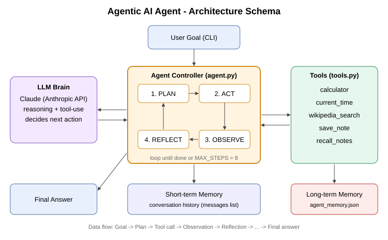

# Agentic AI Agent - Research & Task Assistant

An autonomous agent that takes a high-level goal, **plans**, **acts** with tools,
**observes** results, and **reflects** until it reaches a final answer.



## Agentic features
| Capability | Implementation |
|---|---|
| Planning | System prompt forces a numbered plan before acting |
| Tool use | 5 tools (calculator, clock, Wikipedia, save/recall notes) |
| Autonomy loop | `agent.py` runs Plan -> Act -> Observe -> Reflect up to 8 steps |
| Short-term memory | Conversation history |
| Long-term memory | `agent_memory.json` persisted between runs |
| Safety | AST-based calculator (no `eval`), step limit, tool error handling |

## Run
```bash
pip install -r requirements.txt
export ANTHROPIC_API_KEY=your_key      # Windows: set ANTHROPIC_API_KEY=your_key
python agent.py "Find the population of Tamil Nadu, compute 12% of it, and save the result as a note"
python -m pytest tests                 # offline tests
```
Optional: `CLAUDE_MODEL` env var changes the model.

## Files
- `agent.py` - agent loop and reasoning controller
- `tools.py` - tool schemas + implementations
- `docs/architecture.svg` - schema of the system
- `tests/` - unit tests
